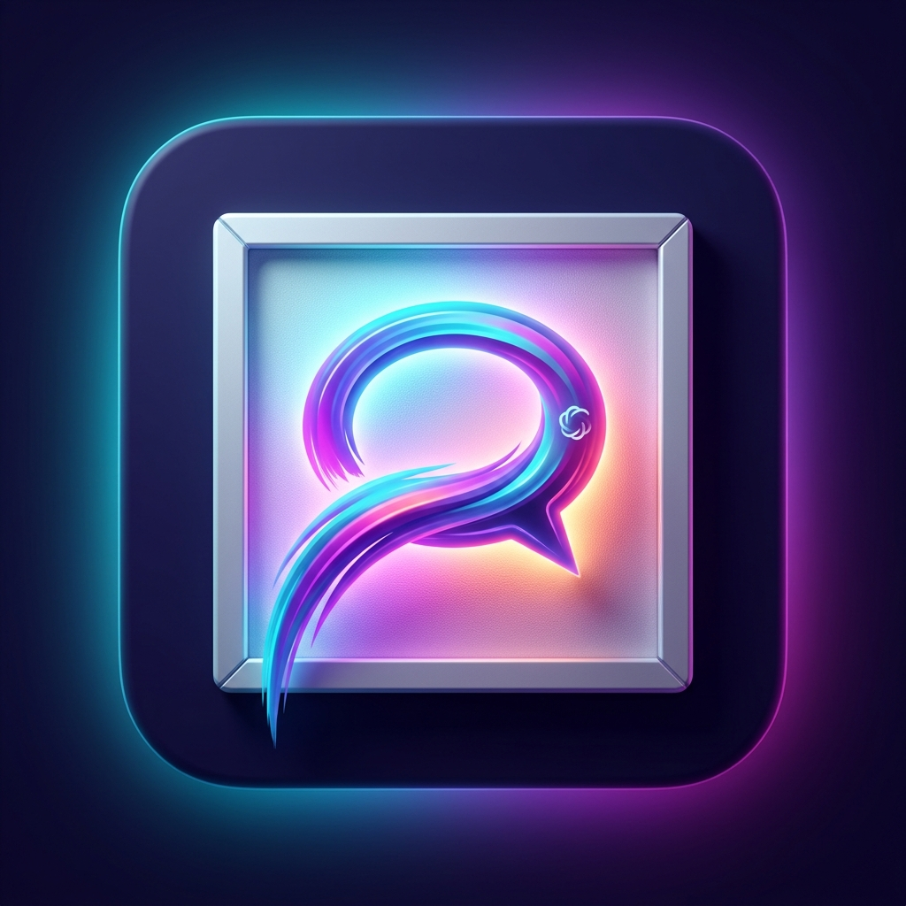

<p align="center">
  
</p>

# Canvas for ChatGPT

Canvas for ChatGPT transforms your ChatGPT interface into a personalized, focused workspace. Customize your chat backdrop with rich imagery, animated GIFs, or looping videos, assign **unique wallpapers to individual ChatGPT chats**, fine-tune blur and opacity, and harmonize seamlessly with light and dark mode.

---

## ✨ Features

- **Per-Chat Wallpapers (New in `v.2.0`)**
  - **Separate Canvas per Conversation**: Give each ChatGPT chat (`/c/...`, Custom GPT `/g/...`, or shared link `/share/...`) its own dedicated wallpaper and visual settings (opacity, blur, and gradient).
  - **Global Default Fallback**: Any new chat or conversation without a custom override automatically uses your **Global Default** wallpaper.
  - **Built-in Manager**: View all chats that have custom wallpapers in the popup, switch between **This Chat** and **Global Default**, or click **Reset to Default** / **Clear All** at any time.
- **Personalized Canvas Backdrops**
  - **Curated Presets**: Quick-select high-definition presets (`Mountain`, `Space`, `Forest`, `Dog Dance`).
  - **Upload Local Media**: Directly upload images, animated GIFs, or looping videos (`MP4`, `WEBM`, `OGG`, `MOV`) from your device.
  - **Custom Web URLs**: Paste any web image, GIF, or video link.
  - **Visual Customization**: Real-time slider controls for backdrop opacity, Gaussian blur radius, and dark/light overlay gradients.
  - **Theme-Aware Engine**: Harmonizes automatically with ChatGPT light and dark modes with deep DOM transparency and clean rounded prompt styling.

- **Privacy & Security**
  - Operates completely client-side in your browser.
  - Zero telemetry, analytics, or external server calls.
  - Settings and per-chat mappings are preserved solely in `chrome.storage.local`.

---

## 🎯 How to Use Per-Chat Wallpapers

1. Open [ChatGPT](https://chatgpt.com) and navigate into any conversation (URL containing `/c/<chat-id>` or `/g/<gpt-id>`).
2. Click the **Canvas for ChatGPT** extension icon in your browser toolbar.
3. Ensure the **This Chat** tab is selected at the top of the popup.
4. Pick a preset, upload local media, or paste a web URL—and optionally fine-tune **Image opacity**, **Image blur**, and **Gradient opacity** just for that chat.
5. Switch to another ChatGPT conversation and repeat to assign a different wallpaper. Navigating between chats swaps the wallpaper automatically.
6. Switch the popup tab to **Global Default** anytime to edit the fallback wallpaper used on the home screen (`/`) and any chat without a custom override, or click **Reset to Default** / **✕** in the **Per-Chat Wallpapers** list to revert a chat back to default.

---

## 🚀 Browser Installation Guide

Download the latest **`canvas-for-chatgpt-v.2.0.zip`** from [GitHub Releases](https://github.com/AryanTechie-007/Canvas-For-ChatGPT/releases) and **extract the ZIP** into a permanent folder on your computer (for example, `Documents/Canvas-For-ChatGPT`).

> **Note:** Do not delete the extracted folder after installing—your browser loads the extension from that folder. If you instead clone the source repo, run `npm install && npm run build` first and select `build/chrome-mv3-prod`.

### Google Chrome
1. Open `chrome://extensions` in the address bar.
2. Turn on **Developer mode** (toggle in the top-right corner).
3. Click **Load unpacked** (top-left).
4. Select the extracted folder (the folder containing `manifest.json`).
5. Pin **Canvas for ChatGPT** from the puzzle-piece Extensions icon in the toolbar and refresh [chatgpt.com](https://chatgpt.com).

### Brave
1. Open `brave://extensions` in the address bar.
2. Enable **Developer mode** (top-right toggle).
3. Click **Load unpacked**.
4. Select the extracted folder containing `manifest.json`.
5. Pin **Canvas for ChatGPT** from the toolbar Extensions menu and refresh [chatgpt.com](https://chatgpt.com).

### Microsoft Edge
1. Open `edge://extensions` in the address bar.
2. Enable **Developer mode** (toggle in the left sidebar or top-right).
3. Click **Load unpacked**.
4. Select the extracted folder containing `manifest.json`.
5. Click the puzzle-piece Extensions icon to show it in the toolbar, then refresh [chatgpt.com](https://chatgpt.com).

### Opera / Opera GX
1. Open `opera://extensions` in the address bar.
2. Turn on **Developer mode** (top-right switch).
3. Click **Load unpacked**.
4. Select the extracted folder containing `manifest.json`.
5. Pin it via the Extensions cube icon in the top-right toolbar and refresh [chatgpt.com](https://chatgpt.com).

### Vivaldi
1. Open `vivaldi://extensions` in the address bar.
2. Toggle **Developer mode** on (top-right).
3. Click **Load unpacked**.
4. Select the extracted folder containing `manifest.json`.
5. Refresh [chatgpt.com](https://chatgpt.com) and click the extension icon in the address bar.

### Arc (Chromium)
1. Open `arc://extensions` (or `chrome://extensions`) in the command bar.
2. Enable **Developer mode** (top-right).
3. Click **Load unpacked** and choose the extracted folder containing `manifest.json`.
4. Refresh [chatgpt.com](https://chatgpt.com) and open the extension from the top-right toolbar / Site Control menu.

### Updating an Existing Installation
When upgrading to a newer release (e.g. `v.2.0`), extract the new release ZIP over your existing folder (or load the new folder) and click the **Reload** (`↻`) button on the **Canvas for ChatGPT** card on your browser's extensions page, then refresh ChatGPT.

### Mozilla Firefox & Safari
- The release ZIP is built for **Chromium Manifest V3** (`chrome-mv3`) browsers listed above and cannot be loaded directly in **Safari** or standard **Firefox**.

---

## 🛠️ Development

### Prerequisites

- Node.js 18 or later
- npm or pnpm

### Getting Started

```bash
# Install dependencies
npm install

# Start development with live reload
npm run dev

# Build production bundle
npm run build

# Run comprehensive browser test suite
npm test

# Package extension zip
npm run package
```

### Architecture

- `content.ts`: Main content script managing backdrop rendering, per-chat route resolution (`/c/...`, `/g/...`, `/share/...`), DOM mutation recovery, and prompt composer styling.
- `popup.tsx`: Toolbar popup UI with **This Chat** vs **Global Default** scope tabs, presets, local upload, custom URLs, visual sliders, and the **Per-Chat Wallpapers** manager.
- `options.tsx`: Options and documentation viewer rendering `README.md`.
- `test/run-browser-tests.js`: End-to-end CDP browser test suite validating background injection, per-chat wallpaper switching, composer wrapper transparency, DOM mutation recovery, and Manifest V3 compliance.

---

## 🔒 Privacy

Canvas for ChatGPT is built with user privacy as a foundational principle:
- **Client-only execution**: Operates solely within browser tab contexts on `https://chatgpt.com/*` and `https://chat.openai.com/*`.
- **No data harvesting**: No prompts, completions, telemetry, or user tokens are gathered, stored remotely, or transmitted.
- **Local configuration**: Custom URLs, uploaded media, per-chat mappings, and styling preferences remain on your device in `chrome.storage.local`.

---

## 📄 License

Licensed under the MIT License. Copyright (c) 2026 AryanTechie-007.
